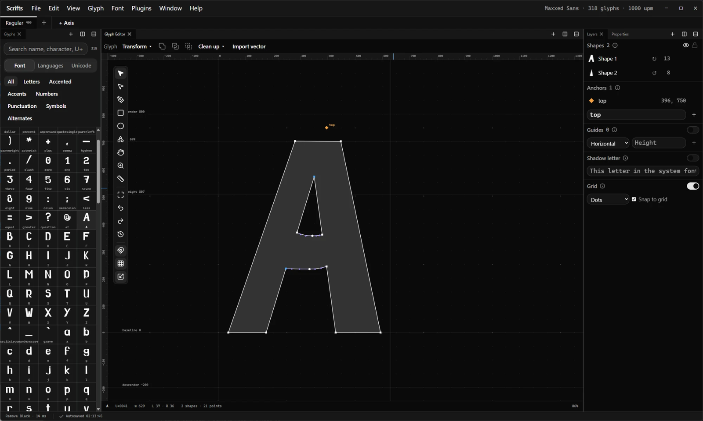

# Scrifts

An open source font editor for Windows and the web. GPL-3.0-or-later.

Scrifts is built on [FontForge](https://fontforge.org) (its engine is used through the Python module, not forked) and
[fontTools](https://github.com/fonttools/fonttools) (variable fonts). All font reading, writing and outline work is theirs;
Scrifts is the interface. See [CREDITS.md](CREDITS.md).

## Download

Get the Windows installer from the [latest release](https://github.com/jobehudev/scrifts/releases/latest) and run it.
It installs for your user only (no admin needed) and contains everything: FontForge's engine is bundled, so there is
nothing else to install and nothing to compile. The rest of this page is for people who want to work on Scrifts.

## What it looks like



Draw and edit outlines with points and shapes; the Layers panel lists the shapes, anchors and guides of the glyph.


Masters make a variable family: the weight slider previews any weight between them, and "Add master here" turns that
blend into a master of its own.


Place an accent once and see it on every letter that uses it.


When masters will not blend, Scrifts shows which points differ and offers the fix.

## Make it yours


Every colour, the interface font (including the font you are editing) and the interface size are settings, not separate
builds. Panels can be dragged, docked and saved as workspaces.

## Development setup (Windows)

Only needed to run Scrifts from source. Needs [FontForge for Windows](https://fontforge.org) (its bundled Python
provides the `fontforge` module), Python 3.12 and Node.

```bash
py -3.12 -m venv .venv && .venv/Scripts/python -m pip install fastapi uvicorn fonttools brotli httpx pytest uharfbuzz Pillow potracer
```
```bash
.venv/Scripts/python -m uvicorn server:app --app-dir backend --port 8765
```
```bash
cd frontend && npm install && npm run dev
```

Open http://localhost:5173. Set `FORGE_FFPYTHON` if FontForge is installed
somewhere other than `C:\Program Files\FontForgeBuilds`.

## Building the installer

Maintainers only. Build it (needs FontForge for Windows installed, Rust, and the dev setup above):

```bash
.venv/Scripts/python packaging/build.py
```

This freezes the backend with PyInstaller (FontForge's own runtime goes inside it), builds the frontend,
and wraps both in an NSIS installer: `src-tauri/target/release/bundle/nsis/Scrifts_<version>_x64-setup.exe`.
It installs per user (no admin needed) and needs no Python, no repo and no separate FontForge.
The installed app writes a log to `%LOCALAPPDATA%\Scrifts\backend.log`.

## Layout

- `backend/worker.py` runs under FontForge's Python: a thin JSON-lines RPC
  shim around `fontforge`. Its operations live by topic in `backend/w_*.py`
  (font, edit, marks, spacing, glyphs, tools, files); `w_state.py` holds the
  font the current request is about.
- `backend/server.py` is the entry point of the FastAPI app. `core.py` has the
  app and the worker client (cancel = kill); the routes live by topic in
  `api_family.py`, `api_glyphs.py`, `api_import.py` and `api_files.py`.
  fontTools is used for variable fonts; `frontend/dist` is served as static files.
- `frontend/` is React + Vite + shadcn/ui; glyphs are drawn on `<canvas>`.
- `src-tauri/` is the native WebView2 desktop shell that spawns and manages
  the backend process.

## Tests

```bash
sh tests/fetch_fixtures.sh
```
```bash
.venv/Scripts/python -m pytest tests
```

The round-trip suite checks 29 real `.sfd` files from FontForge's own test
suite, plus TTF, OTF and UFO; see the docstrings in `tests/` for what is
compared and why. Benchmarks are in `bench/`; what's next is in
`ROADMAP.md`.

## Licence

Scrifts is free software under the [GNU GPL v3 or later](LICENSE). You may use, study, change and share it, as long as
your version stays under the same licence and comes with its source.

The Windows installer includes FontForge's own Windows build, unchanged
(GPL-3.0-or-later, [source](https://github.com/fontforge/fontforge)). Its licence is installed with the app. Other
libraries and their licences are listed in [CREDITS.md](CREDITS.md).

## Contributing

Not taking pull requests yet. Bug reports and ideas are welcome as issues.
