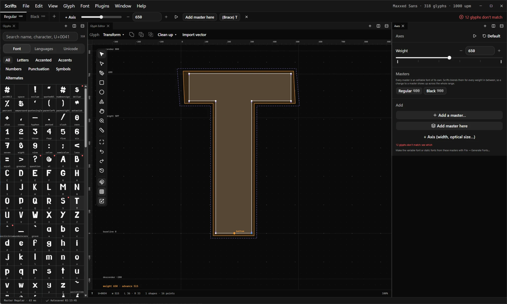
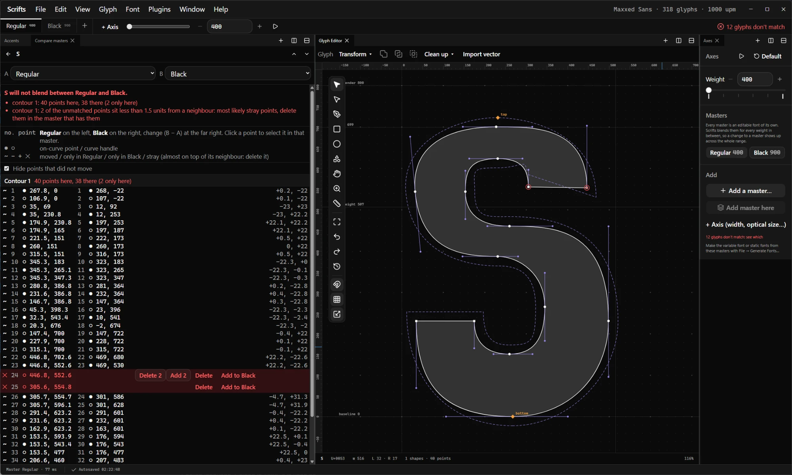
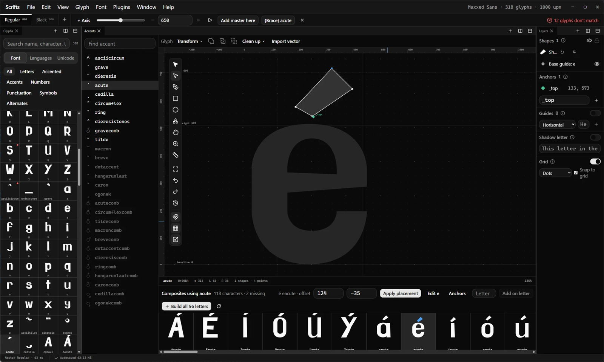
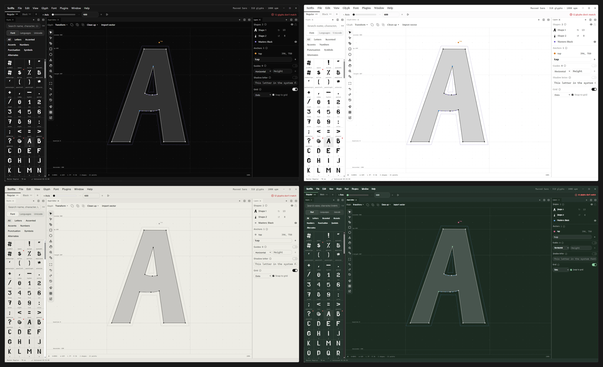

<p align="center">
  <picture>
    <source media="(prefers-color-scheme: dark)" srcset="docs/wordmark-light.svg">
    
  </picture>
</p>

A free, open source font editor for Windows.

Early release (v0.1): expect rough edges, and please [file an issue](https://github.com/jobehudev/scrifts/issues) when
you hit one. Windows only for now.

Draw glyphs, build variable fonts from masters, place accents, space and kern, and export to TTF, OTF, WOFF and WOFF2.
GPL-3.0-or-later.

Scrifts is built on [FontForge](https://fontforge.org) (its engine is used through the Python module, not forked) and
[fontTools](https://github.com/fonttools/fonttools) (variable fonts). All font reading, writing and outline work is
theirs; Scrifts is the interface. See [CREDITS.md](CREDITS.md).


## Download

Grab the Windows installer from the [latest release](https://github.com/jobehudev/scrifts/releases/latest) and run it.
It installs for your user only (no admin needed) and bundles FontForge's engine, so there is nothing else to install
and nothing to compile.

The installer is not code-signed yet, so Windows SmartScreen may say "Windows protected your PC". Click **More info**,
then **Run anyway**.

Want to hack on it instead? Skip to [Running from source](#running-from-source).

## First steps

1. Start the app and pick **File > New Font**, or open a font you already have (`.ttf`, `.otf`, `.ufo`, `.glyphs`, `.sfd`).
2. Click a glyph in the grid to open it in the editor.
3. Draw with the pen tool, drag points to reshape, and check the result in the weight preview if you have masters.
4. **File > Generate Fonts** (Ctrl Shift G) writes TTF, OTF, WOFF or WOFF2.

## What you can do

**Draw with points and shapes.** The Layers panel lists every shape, anchor and guide of the glyph.

**Make variable fonts.** Add masters and the weight slider previews any weight in between. "Add master here" turns the
blend into a master of its own.



**Fix mismatched masters.** When masters will not blend, Scrifts marks the points that differ and offers the fix.



**Place accents once.** Position an accent and see it on every letter that uses it.



**Work with the formats you already have.** Open and save `.glyphs`, `.ufo`, `.sfd`, `.otf` and `.ttf`, plus
`.designspace` projects for masters. Export OTF, TTF, WOFF and WOFF2. Trace a picture into a glyph, and round-trip
outlines with Illustrator through SVG.

**Script the boring parts.** `File > Execute Script` runs Python on the open font, with `font`, `fontforge` and `psMat`
ready to use, so batch jobs such as rounding coordinates or adjusting sidebearings across a whole set take a few
lines. For repeatable jobs, a [plugin](plugins/README.md) is a folder with a `plugin.json` and a `main.py`; Scrifts
draws the settings form for you, and the ones in `plugins/` are good starting points.

## Make it yours

Colours, the interface font (even the font you are editing) and the interface size are all settings, not separate
builds. Panels can be dragged, docked and saved as workspaces.



## About AI

Scrifts is developed with AI assistance. I decide and closely moderate the architecture and infrastructure; the AI
mostly writes the boilerplate.

Scrifts does not generate fonts with AI and has no such feature: the glyphs are yours, drawn or traced by you.
Support actual artists and designers.

## Running from source

You need [FontForge for Windows](https://fontforge.org) (its bundled Python provides the `fontforge` module),
Python 3.12 and Node.

```bash
py -3.12 -m venv .venv && .venv/Scripts/python -m pip install fastapi uvicorn fonttools brotli httpx pytest uharfbuzz Pillow potracer
```
```bash
.venv/Scripts/python -m uvicorn server:app --app-dir backend --port 8765
```
```bash
cd frontend && npm install && npm run dev
```

Then open http://localhost:5173. If FontForge is not in `C:\Program Files\FontForgeBuilds`, set `FORGE_FFPYTHON` to
its location.

### How the code is laid out

- `backend/worker.py` runs under FontForge's Python: a thin JSON-lines RPC shim around `fontforge`. Its operations live
  by topic in `backend/w_*.py` (font, edit, marks, spacing, glyphs, tools, files); `w_state.py` holds the font the
  current request is about.
- `backend/server.py` is the FastAPI entry point. `core.py` has the app and the worker client (cancel = kill); routes
  live by topic in `api_family.py`, `api_glyphs.py`, `api_import.py` and `api_files.py`. `frontend/dist` is served as
  static files.
- `frontend/` is React + Vite + shadcn/ui; glyphs are drawn on `<canvas>`.
- `src-tauri/` is the native WebView2 desktop shell that spawns and manages the backend process.

### Tests

```bash
sh tests/fetch_fixtures.sh
```
```bash
.venv/Scripts/python -m pytest tests
```

The round-trip suite checks 29 real `.sfd` files from FontForge's own test suite, plus TTF, OTF and UFO. The docstrings
in `tests/` say what is compared and why. Benchmarks are in `bench/`.

### Building the installer

Maintainers only. You need FontForge for Windows, Rust and the setup above.

```bash
.venv/Scripts/python packaging/build.py
```

This freezes the backend with PyInstaller (FontForge's runtime goes inside it), builds the frontend and wraps both in an
NSIS installer at `src-tauri/target/release/bundle/nsis/Scrifts_<version>_x64-setup.exe`. The installed app logs to
`%LOCALAPPDATA%\Scrifts\backend.log`.

## Roadmap and contributing

What's next is in [ROADMAP.md](ROADMAP.md). Not taking pull requests yet, but bug reports and ideas are welcome as
issues.

## Licence

Scrifts is free software under the [GNU GPL v3 or later](LICENSE). Use, study, change and share it, as long as your
version stays under the same licence and ships with its source.

The Windows installer includes FontForge's own Windows build, unchanged
(GPL-3.0-or-later, [source](https://github.com/fontforge/fontforge)); its licence is installed with the app. Other
libraries and their licences are in [CREDITS.md](CREDITS.md).
